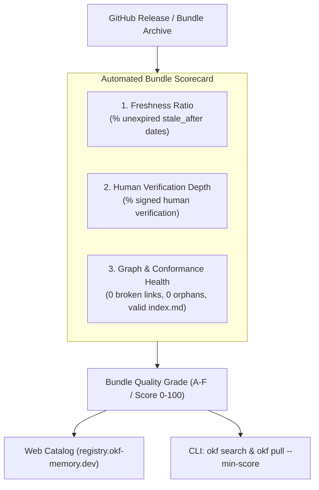

# OKF Registry Roadmap

This roadmap outlines planned features, security enhancements, and quality assurance capabilities for the **OKF Registry** (`https://registry.okf-memory.dev`) and the decentralized agent memory ecosystem.

---

## 🎯 Upcoming Milestones

### 1. Pre-Pull Bundle Quality Scorecards (Community RFC by David White)

**Problem:** Cryptographic SHA-256 hashes in `okf.lock` guarantee *immutability* (tamper-proofing), but do not guarantee *freshness*, *correctness*, or *active ownership*. Without pre-pull quality signals, unmaintained or stale bundles become "reproducibly wrong" across every agent repository that installs them.

**Goal:** Surface an OpenSSF-style Quality Scorecard for every published bundle directly on the web catalog and in the `okf` CLI prior to installation.

#### Key Dimensions & Scoring Metrics:
* **Freshness Ratio (40%):**
  * Evaluates frontmatter `stale_after: YYYY-MM-DD` declarations across concepts.
  * Measures median review age and penalizes concepts exceeding their review deadline.
* **Human Stewardship & Provenance (35%):**
  * Distinguishes human verification (`verified.by: human/*`) from raw agent generation (`generated.by: agent/*`).
  * Rewards bundles with verified human maintainers and penalizes unreviewed synthetic dumps.
* **Structural & Conformance Integrity (25%):**
  * Evaluated via `okf validate --strict --drift`.
  * Verifies zero broken links, zero orphan nodes, index navigation consistency, and active status (`stable` vs. `deprecated`).

#### Deliverables:
- [ ] Static Scorecard Scanner during `scripts/build` catalog generation.
- [ ] Visual Scorecard Badges & Quality breakdown on bundle pages in `registry.okf-memory.dev`.
- [ ] Manifest Scorecard integration (`/bundles/<id>.json` includes `quality_score` and `freshness_grade`).
- [ ] CLI Gating: Support `okf pull <bundle> --min-score 80` (with optional granular `--min-freshness 80`) and `okf search` quality indicators.

---

### 2. Automated Ecosystem Crawler for Community Bundles

* Automatically index GitHub repositories tagged with [`okf-memory-bundle`](https://github.com/topics/okf-memory-bundle).
* Run nightly health checks on indexed community bundles.
* Flag unmaintained or archived GitHub repositories.

---

### 3. Namespace Verification & Organization Badging

* Verified publisher badges for organization namespaces (`@org/bundle`).
* Cryptographic commit/tag signature verification against GitHub release authors.

---

### 4. Zero-Knowledge Private Vault Mirrors

* Native registry proxy support for self-hosted enterprise registries (`--registry https://registry.corp.internal`).
* Enterprise policy enforcement: block unverified external bundles in corporate CI pipelines.
