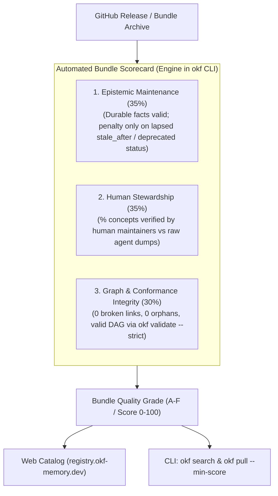

# OKF Registry Roadmap

This roadmap outlines planned features, security enhancements, and quality assurance capabilities for the **OKF Registry** (`https://registry.okf-memory.dev`) and the decentralized agent memory ecosystem.

---

## 🎯 Upcoming Milestones

### 1. Pre-Pull Bundle Quality Scorecards (Community RFC by David White, Refined)

**Problem:** Cryptographic SHA-256 hashes in `okf.lock` guarantee *immutability* (tamper-proofing), but do not guarantee *veracity*, *correctness*, or *active ownership*. Without pre-pull quality signals, unmaintained or stale bundles become "reproducibly wrong" across agent repositories.

However, knowledge bundles differ fundamentally from ephemeral code libraries: many concepts represent version-bound invariants (e.g. Next.js 15 caching defaults or Tailwind v4 tokens) that remain true indefinitely. Forcing arbitrary `stale_after` dates on immutable facts creates "maintenance theater" (meaningless date bumps to keep a score green). Upstream changes are governed via semantic versioning (SemVer `v1.0.0` -> `v1.1.0`) or `status: deprecated`, not artificial calendar countdowns.

**Goal:** Surface an OpenSSF-style Quality Scorecard directly on the web catalog and enforce it hermetically in the `okf` CLI prior to installation.

#### Core Architecture & SSoT
The scorecard evaluation engine lives canonically in the **`okf` CLI / core library** (`okf-agent-memory`), exposed via `okf scorecard` (or `okf validate --scorecard --json`). 
* The Registry catalog generator (`scripts/build`) and crawler invoke the `okf` CLI to compute authoritative scores for `public/bundles/<id>.json` and `public/index.json`.
* The `okf` CLI client (`okf pull --min-score <N>`) evaluates bundles deterministically on the consumer side without blind trust in external manifest claims.

#### Key Dimensions & Scoring Metrics:
* **Epistemic Maintenance & Relevance (35%):**
  * Invariant & version-bound facts without `stale_after` are treated as 100% valid by default (rejecting artificial maintenance theater).
  * Targeted lapsed penalty: Concepts that explicitly opt in to `stale_after` (living runbooks, temporary workarounds) and let it lapse incur hard freshness deductions.
  * Status penalty: Bundles or concepts marked as `status: deprecated` are heavily penalized.
* **Human Stewardship & Provenance (35%):**
  * Distinguishes human verification (`verified.by: human/*` or `user/*`) from unvetted synthetic generation (`generated.by: agent/*`).
  * Rewards bundles with verified human maintainers and penalizes unreviewed synthetic dumps.
* **Graph & Conformance Integrity (30%):**
  * Evaluated via `okf validate --strict`.
  * Verifies zero broken links, zero orphan nodes, index navigation consistency, and strict OKF v0.2 spec conformance.

#### Deliverables:
- [ ] Implement Scorecard Engine in `okf` CLI (`pkg/okf/scorecard.go` and `okf validate --scorecard --json`).
- [ ] CLI Gating: Support `okf pull <bundle> --min-score 80` (with optional `--min-stewardship 80`) and `okf search` quality indicators.
- [ ] Static Scorecard Integration in `registry/scripts/build` catalog generation.
- [ ] Manifest Scorecard integration (`/bundles/<id>.json` and `index.json` include `scorecard: { score, grade, maintenance, stewardship, integrity }`).
- [ ] Visual Scorecard Badges & Quality breakdown on bundle pages in `registry.okf-memory.dev`.

---

### 2. Automated Ecosystem Crawler for Community Bundles

* Automatically index GitHub repositories tagged with [`okf-memory-bundle`](https://github.com/topics/okf-memory-bundle).
* Run nightly health checks on indexed community bundles.
* Flag unmaintained or archived GitHub repositories.

---

### 3. Namespace Verification & Organization Badging

* Verified publisher badges for organization namespaces (`@org/bundle`).
* Cryptographic commit/tag signature verification against GitHub release authors.

---

### 4. Zero-Knowledge Private Vault Mirrors

* Native registry proxy support for self-hosted enterprise registries (`--registry https://registry.corp.internal`).
* Enterprise policy enforcement: block unverified external bundles in corporate CI pipelines.
